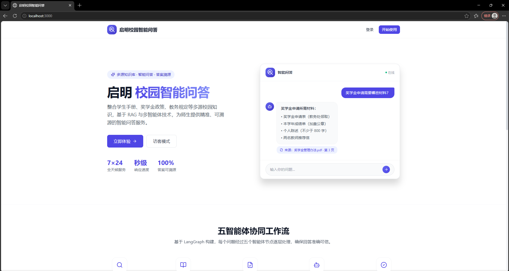
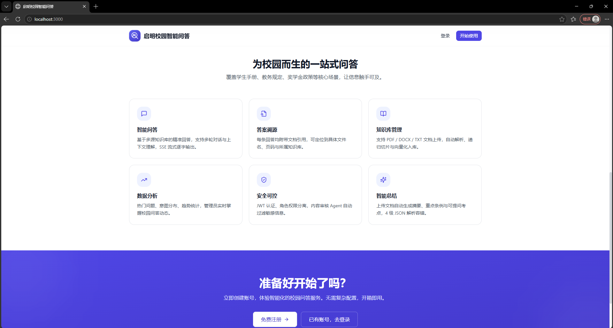
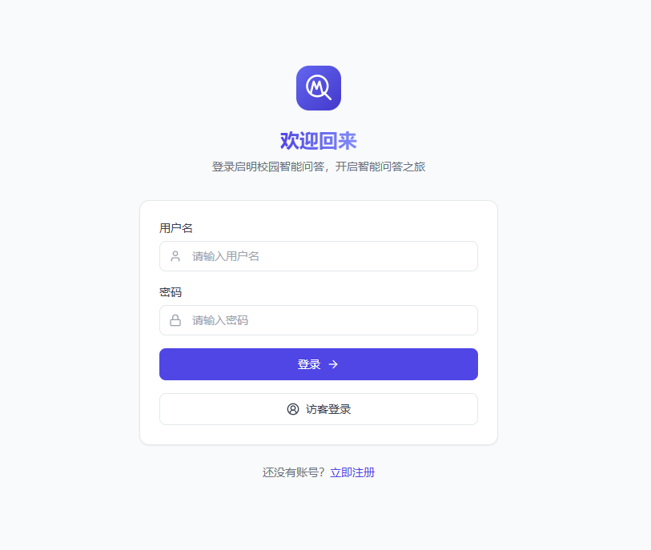
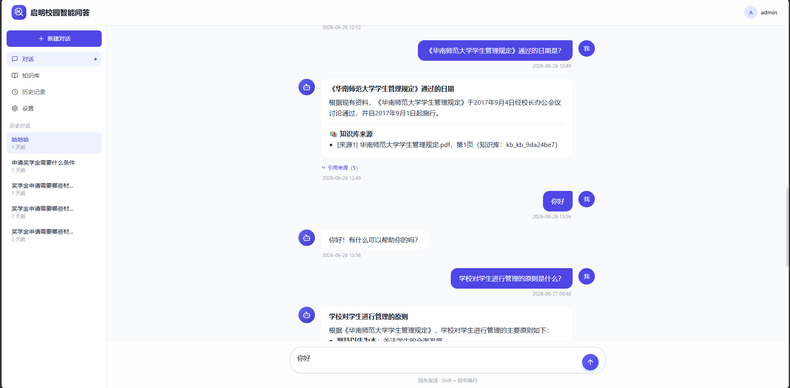
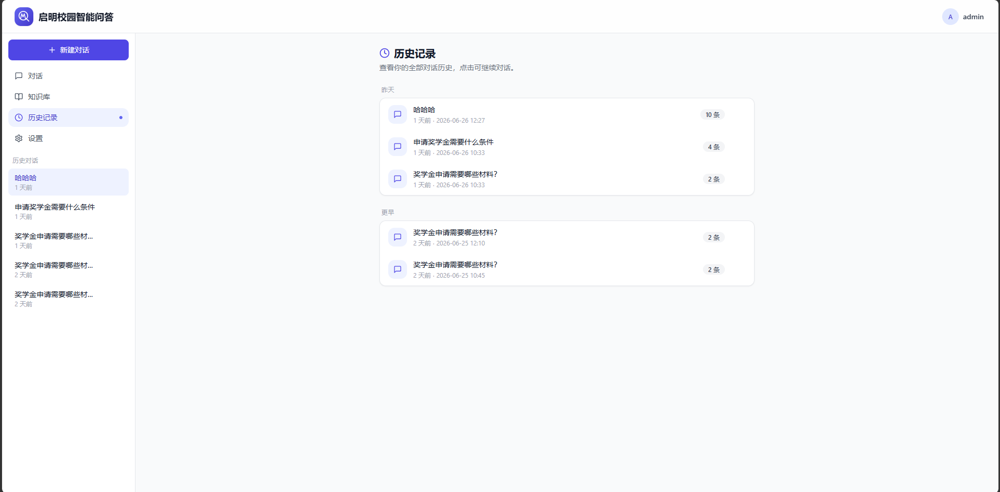
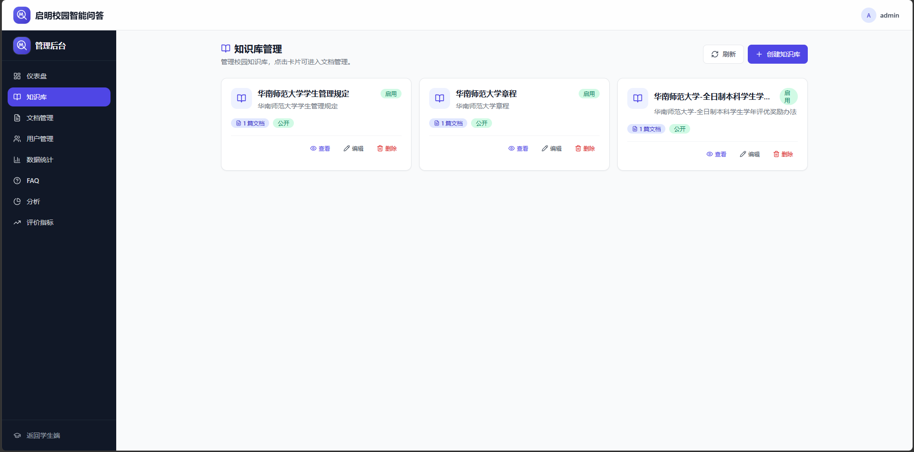
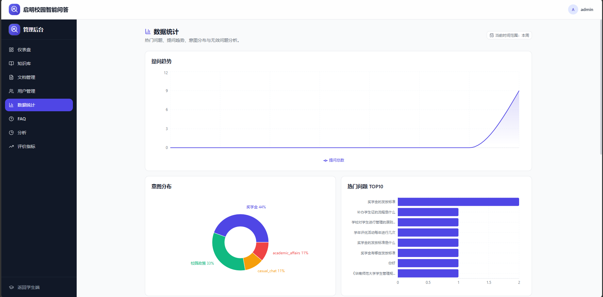

# 校园多源知识库智能问答助手

基于 LangGraph、LangChain、FastAPI 和 Next.js 构建的校园知识库问答助手。

> **版本**：v2.0 | **更新日期**：2026-06-26
>
> v2.0 变更：修复 SSE 流式响应、文档上传超时、仪表盘统计、历史对话命名、回答格式规范、考点 JSON 解析等多个核心问题，详见 [项目说明文档](./PROJECT_GUIDE.md)。

---

## 界面预览

### 首页与登录

| 页面 | 截图 | 描述 |
|------|------|------|
| 首页 |  | 系统首页展示 |
| 首页详情 |  | 首页功能介绍 |
| 登录界面 |  | 用户登录入口 |

### 学生端界面

| 页面 | 截图 | 描述 |
|------|------|------|
| 聊天界面 |  | 智能聊天对话，支持 SSE 流式逐字输出 |
| 对话历史 |  | 历史会话管理，支持重命名与删除 |
| 知识库 |  | 知识库浏览与文档详情 |

### 管理端界面

| 页面 | 截图 | 描述 |
|------|------|------|
| 数据分析 |  | 问答数据统计面板（意图分布、热门问题） |

---

## 项目架构

```
┌─────────────────────────────────────────────────────────────────┐
│                        前端 (Next.js)                           │
│  ┌──────────────┐    ┌──────────────┐                          │
│  │   学生端      │    │   管理端      │                          │
│  │ 聊天/知识库/历史│   │仪表盘/文档管理│                          │
│  └──────┬───────┘    └──────┬───────┘                          │
└─────────┼───────────────────┼──────────────────────────────────┘
          │                   │
          ▼                   ▼
┌─────────────────────────────────────────────────────────────────┐
│                        后端 (FastAPI)                           │
│  ┌─────────┐ ┌──────────────┐ ┌─────────────────────────────┐  │
│  │  API    │ │   Services   │ │       LangGraph 多智能体      │  │
│  │ 路由层  │ │ 业务逻辑层   │ │ 意图→检索→溯源→回答→审核      │  │
│  └────┬────┘ └──────┬───────┘ └─────────────────┬─────────────┘  │
│       │             │                           │                 │
│       ▼             ▼                           ▼                 │
│  ┌─────────┐ ┌──────────────┐ ┌─────────────────────────────┐  │
│  │ SQLite  │ │  RAG 系统    │ │         ChromaDB            │  │
│  │ 业务数据 │ │ 文档解析/向量化│ │ 向量数据库(含内存后备)      │  │
│  └─────────┘ └──────────────────┘ └─────────────────────────────┘  │
└─────────────────────────────────────────────────────────────────┘
          │
          ▼
┌─────────────────────────────────────────────────────────────────┐
│                    LLM 提供商 (可选其一)                         │
│  ┌──────────────┐    ┌──────────────┐    ┌──────────────┐      │
│  │   Ollama     │    │   OpenAI     │    │  DeepSeek    │      │
│  │  本地离线    │    │   云端 API   │    │   云端 API   │      │
│  │ qwen2.5:7b   │    │  gpt-4o-mini │    │ deepseek-chat│      │
│  └──────────────┘    └──────────────┘    └──────────────┘      │
└─────────────────────────────────────────────────────────────────┘
```

---

## 技术栈

### 后端
| 技术 | 版本 | 用途 |
|------|------|------|
| Python | 3.13.12 | 运行时 |
| FastAPI | 0.115.6 | Web 框架 |
| SQLAlchemy | 2.0.36 | 异步 ORM |
| Pydantic | 2.10.4 | 数据验证 |
| LangGraph | 0.2.60 | 多智能体工作流 |
| LangChain | 0.3.14 | LLM 编排 |
| ChromaDB | 0.5.23 | 向量数据库 |
| PyPDF2 | 3.0.1 | PDF 解析 |
| python-docx | 1.1.2 | Word 解析 |
| JWT | python-jose | 认证 |
| bcrypt | 5.0.0 | 密码哈希 |

### 前端
| 技术 | 版本 | 用途 |
|------|------|------|
| Next.js | 14.2.20 | React 框架 |
| TailwindCSS | 3 | 样式系统 |
| Zustand | 4.5.2 | 状态管理 |
| Recharts | 2.12.7 | 图表 |
| Axios | 1.6.7 | HTTP 请求 |

---

## 功能模块

### 学生端
1. **智能聊天对话** - 基于多智能体 RAG 的问答系统，支持 SSE 流式逐字输出、多轮对话记忆
2. **知识库浏览** - 查看校园公开知识库列表、文档详情与智能总结
3. **对话历史** - 查看历史聊天记录，支持**会话重命名**与删除
4. **文档总结** - 查看上传文档的自动生成摘要、重点条例、可提问考点
5. **引用溯源** - 回答末尾统一展示知识库来源（文件名、页码、所属知识库）
6. **设置** - 个人信息管理

### 管理端
1. **仪表盘** - 系统数据概览（用户总数、知识库数、总对话数、今日提问数）
2. **知识库管理** - 创建/编辑/删除知识库，支持公开/私有设置
3. **文档管理** - 文件上传（PDF/Word/TXT/Markdown）、删除、重新索引，异步处理不阻塞
4. **用户管理** - 管理系统用户
5. **数据统计** - 问答数据统计面板（意图分布、热门问题、无效问题分析）
6. **FAQ 管理** - 热门问题自动统计与管理

### 创新功能
1. **智能文档总结** - 上传文件后自动生成：文件摘要、重点条例、可提问考点
2. **热门问题统计** - 自动统计学生高频提问，生成校园 FAQ
3. **回答格式规范** - 智能体回答使用 Markdown 结构（小标题、列表），知识库来源统一附在末尾

---

## 快速开始

### 环境要求

- Python 3.13+
- Node.js 18+ (前端)
- **LLM 提供商（任选其一）**：
  - Ollama（推荐，完全免费，本地运行）
  - OpenAI API Key
  - DeepSeek API Key

---

### 方式一：使用 Ollama（推荐，完全免费）

#### 1. 安装 Ollama

下载地址：https://ollama.com/download/windows

安装后确保 Ollama 在 PATH 中：

```powershell
ollama --version
```

#### 2. 拉取模型

```powershell
# 对话模型（约 4.7GB）
ollama pull qwen2.5:7b

# 嵌入模型（约 274MB）
ollama pull nomic-embed-text

# 验证
ollama list
```

#### 3. 配置后端

编辑 `backend/.env`：

```ini
LLM_PROVIDER=ollama
OLLAMA_BASE_URL=http://localhost:11434
LLM_MODEL=qwen2.5:7b
OLLAMA_EMBEDDING_MODEL=nomic-embed-text
OPENAI_API_KEY=
LOCAL_EMBEDDING_MODEL=
```

---

### 方式二：使用 OpenAI / DeepSeek API

编辑 `backend/.env`：

```ini
LLM_PROVIDER=openai
OPENAI_API_KEY=sk-your-api-key
OPENAI_API_BASE=https://api.openai.com/v1    # 或 https://api.deepseek.com/v1
LLM_MODEL=gpt-4o-mini                         # 或 deepseek-chat
EMBEDDING_MODEL=text-embedding-ada-002        # 或 BAAI/bge-m3 (SiliconFlow)
```

---

### 后端启动

```powershell
# 1. 激活虚拟环境
conda activate campus

# 2. 安装依赖（首次）
cd backend
pip install -r requirements.txt

# 3. 启动服务
python run.py
```

服务启动后访问：http://localhost:8000

API 文档：http://localhost:8000/docs

---

### 前端启动

```powershell
# 1. 安装依赖（首次）
cd frontend
npm install

# 2. 启动开发服务器
npm run dev
```

访问：http://localhost:3000

---

### 初始账号

| 用户名 | 密码 | 角色 |
|--------|------|------|
| admin | admin123456 | 管理员 |

---

## API 接口

### 认证接口
| 方法 | 路径 | 说明 |
|------|------|------|
| POST | /api/v1/auth/login | 用户登录 |
| POST | /api/v1/auth/register | 用户注册 |
| POST | /api/v1/auth/refresh | 刷新令牌 |
| GET | /api/v1/auth/me | 当前用户信息 |

### 聊天接口
| 方法 | 路径 | 说明 |
|------|------|------|
| POST | /api/v1/chat | 发送消息（非流式） |
| POST | /api/v1/chat/stream | 发送消息（SSE 流式，直连后端绕过 Next.js 代理） |
| GET | /api/v1/chat/sessions | 获取会话列表 |
| GET | /api/v1/chat/sessions/{id}/messages | 获取会话消息 |
| PATCH | /api/v1/chat/history/{id} | 重命名会话 |
| DELETE | /api/v1/chat/sessions/{id} | 删除会话 |

### 知识库接口
| 方法 | 路径 | 说明 |
|------|------|------|
| POST | /api/v1/knowledge/create | 创建知识库 |
| GET | /api/v1/knowledge/list | 知识库列表 |
| GET | /api/v1/knowledge/{id} | 知识库详情 |
| PUT | /api/v1/knowledge/{id} | 更新知识库 |
| DELETE | /api/v1/knowledge/{id} | 删除知识库 |

### 文档接口
| 方法 | 路径 | 说明 |
|------|------|------|
| POST | /api/v1/documents/{kb_id}/upload | 上传文档 |
| GET | /api/v1/documents/{kb_id}/list | 文档列表 |
| DELETE | /api/v1/documents/doc/{doc_id} | 删除文档 |
| POST | /api/v1/documents/doc/{doc_id}/reindex | 重新索引 |

### 总结接口
| 方法 | 路径 | 说明 |
|------|------|------|
| GET | /api/v1/summary/document/{doc_id} | 获取文档总结 |
| GET | /api/v1/summary/document/{doc_id}/rules | 获取重点条例 |
| GET | /api/v1/summary/document/{doc_id}/questions | 获取可提问考点 |

### FAQ 接口
| 方法 | 路径 | 说明 |
|------|------|------|
| GET | /api/v1/faq | FAQ 列表 |
| POST | /api/v1/faq | 创建 FAQ |
| PUT | /api/v1/faq/{id} | 更新 FAQ |
| DELETE | /api/v1/faq/{id} | 删除 FAQ |

### 统计接口
| 方法 | 路径 | 说明 |
|------|------|------|
| GET | /api/v1/stats/dashboard | 仪表盘统计 |
| GET | /api/v1/stats/usage | 使用统计 |

---

## 目录结构

```
campus_assistant/
├── backend/                    # 后端代码
│   ├── app/
│   │   ├── __init__.py
│   │   ├── main.py             # FastAPI 入口
│   │   ├── config.py           # 配置管理
│   │   ├── dependencies.py     # 全局依赖
│   │   ├── core/               # 核心模块
│   │   │   ├── exceptions.py   # 异常处理
│   │   │   ├── logging.py      # 日志配置
│   │   │   ├── security.py     # 安全工具(JWT/密码)
│   │   │   └── llm_factory.py  # LLM 工厂(支持 Ollama/OpenAI)
│   │   ├── db/                 # 数据库
│   │   │   ├── base.py         # 模型基类
│   │   │   └── session.py      # 会话管理
│   │   ├── models/             # ORM 模型
│   │   ├── schemas/            # Pydantic Schema
│   │   ├── api/                # API 路由
│   │   │   └── v1/             # v1 版本路由
│   │   ├── services/           # 业务服务层
│   │   ├── agents/             # LangGraph 多智能体
│   │   │   ├── state.py        # 状态定义
│   │   │   ├── graph.py        # 图构建
│   │   │   └── nodes/          # 节点实现
│   │   │       ├── intent_node.py    # 意图识别
│   │   │       ├── answer_node.py    # 回答生成
│   │   │       └── review_node.py    # 内容审核
│   │   └── rag/                # RAG 系统
│   │       ├── processors/     # 文档解析器
│   │       ├── embeddings/     # 嵌入模型(支持 Ollama/OpenAI/HuggingFace)
│   │       ├── vectorstore/    # 向量存储(含内存后备)
│   │       ├── retrievers/     # 检索器
│   │       ├── prompts/        # 提示词
│   │       └── summarizer/     # 文档总结
│   ├── data/                   # 数据目录(SQLite/ChromaDB)
│   ├── run.py                  # 启动脚本
│   ├── requirements.txt        # 依赖清单
│   ├── .env                    # 环境变量
│   └── .env.example           # 环境变量示例
├── frontend/                   # 前端代码
│   ├── src/
│   │   ├── app/                # Next.js App Router
│   │   ├── components/         # 组件
│   │   │   ├── ui/             # 通用 UI 组件
│   │   │   ├── layout/         # 布局组件
│   │   │   ├── chat/           # 聊天相关组件
│   │   │   ├── summary/        # 总结组件
│   │   │   └── admin/          # 管理端组件
│   │   ├── lib/                # 工具函数
│   │   │   ├── api.ts          # API 封装
│   │   │   └── hooks/          # 自定义 Hooks
│   │   ├── store/              # Zustand 状态管理
│   │   └── types/              # TypeScript 类型
│   ├── package.json
│   ├── next.config.js
│   ├── tailwind.config.ts
│   └── tsconfig.json
└── README.md                   # 项目说明
```

---

## 多智能体工作流

系统采用 LangGraph 构建 5 个智能体协同工作：

1. **意图识别 Agent** - 识别用户问题类型（校内知识/闲聊/敏感内容）
2. **检索 Agent** - 根据意图从知识库检索相关文档片段
3. **溯源 Agent** - 提取检索结果中的文档来源信息
4. **回答生成 Agent** - 根据检索内容生成自然语言回答
5. **审核 Agent** - 审核回答内容，过滤敏感词，确保合规

```
用户提问 → 意图识别 → [校内知识] → 检索 → 溯源 → 回答生成 → 审核 → 返回回答
                          │
                          └→ [闲聊/敏感] → 拒绝回答
```

---

## 配置说明

### .env 环境变量

```bash
# 应用配置
APP_NAME=校园多源知识库智能问答助手
DEBUG=True
SECRET_KEY=your-secret-key-change-in-production
ALGORITHM=HS256
ACCESS_TOKEN_EXPIRE_MINUTES=1440
REFRESH_TOKEN_EXPIRE_DAYS=7

# 数据库
DATABASE_URL=sqlite+aiosqlite:///./data/sqlite/campus.db

# ChromaDB
CHROMA_PERSIST_DIR=./data/chroma

# LLM 提供商配置
LLM_PROVIDER=ollama                          # openai / ollama
OPENAI_API_KEY=                              # OpenAI/DeepSeek API Key
OPENAI_API_BASE=https://api.openai.com/v1   # 或 https://api.deepseek.com/v1
LLM_MODEL=qwen2.5:7b                         # 对话模型
EMBEDDING_MODEL=text-embedding-ada-002       # OpenAI 嵌入模型

# Ollama 配置（LLM_PROVIDER=ollama 时生效）
OLLAMA_BASE_URL=http://localhost:11434
OLLAMA_EMBEDDING_MODEL=nomic-embed-text      # Ollama 嵌入模型

# 本地 Embedding 模型（可选，为空则使用 LLM_PROVIDER 对应的嵌入）
LOCAL_EMBEDDING_MODEL=

# 文件上传
UPLOAD_DIR=./data/uploads
MAX_FILE_SIZE=52428800

# CORS
CORS_ORIGINS=["http://localhost:3000","http://127.0.0.1:3000"]
```

---

## LLM 提供商对比

| 提供商 | 成本 | 优点 | 缺点 |
|--------|------|------|------|
| **Ollama** | 完全免费 | 本地运行、无网络依赖、数据安全 | 需本地算力、首次下载模型较大 |
| **OpenAI** | 按量付费 | 高质量回答、稳定 | 需付费、网络依赖 |
| **DeepSeek** | 极低成本 | 价格便宜、国内访问快 | 需付费、无专用 Embedding |
| **SiliconFlow** | 免费额度 | 国内访问快、有免费 Embedding | 需注册 |

---

## 注意事项

### 1. ChromaDB 安装问题

在 Windows 上安装 `chromadb` 可能需要 Microsoft Visual C++ 14.0+。若编译失败，系统会自动降级为内存向量存储（关键词匹配检索），不影响基本功能。

**解决方案**：
- 安装 Microsoft Visual C++ Build Tools
- 或使用 `pip install chromadb --only-binary=:all:`

### 2. Embedding 模型优先级

系统按以下优先级选择 Embedding：

1. `LOCAL_EMBEDDING_MODEL`（HuggingFace 本地模型）
2. `OLLAMA_EMBEDDING_MODEL`（当 `LLM_PROVIDER=ollama`）
3. `EMBEDDING_MODEL`（OpenAI 嵌入）
4. 哈希嵌入（降级后备）

### 3. 文件上传

支持格式：PDF、Word (.docx)、TXT、纯文本公告

### 4. 后端启动脚本

`run.py` 会自动创建数据库表和初始管理员账号（admin/admin123456）。

---

## 测试流程

1. 启动后端服务：`python run.py`
2. 启动前端服务：`npm run dev`
3. 访问 http://localhost:3000
4. 登录（admin/admin123456）
5. 创建知识库并上传校园相关文档
6. 在聊天界面提问测试
7. 查看回答底部的溯源来源

---

## 问题排查

- 查看后端日志：`backend/logs/` 目录
- 检查端口占用：`netstat -ano | findstr :8000`
- 数据库文件位置：`backend/data/sqlite/campus.db`
- ChromaDB 数据位置：`backend/data/chroma/`
- Ollama 服务状态：`ollama list`

---

## 部署说明

### Vercel 部署前端（推荐）

1. 在 GitHub 上创建项目仓库
2. 访问 [Vercel](https://vercel.com/) 并登录
3. 点击 **Add New Project** → 选择你的仓库
4. 配置构建命令：
   - Framework Preset: Next.js
   - Build Command: `npm run build`
   - Output Directory: `.next`
5. 添加环境变量（Settings → Environment Variables）：
   ```
   NEXT_PUBLIC_API_URL=https://your-backend-url.com
   ```
6. 点击 **Deploy**

### Docker 部署（完整项目）

```bash
# 构建镜像
docker-compose build

# 启动服务
docker-compose up -d
```

---

## 贡献指南

欢迎提交 Issue 和 Pull Request！

### 开发流程

1. Fork 本仓库
2. 创建功能分支：`git checkout -b feature/xxx`
3. 提交代码：`git commit -m 'feat: xxx'`
4. 推送到远程：`git push origin feature/xxx`
5. 创建 Pull Request

### 代码规范

- 后端：遵循 PEP 8 规范
- 前端：遵循 ESLint 规范
- 提交信息：使用 Conventional Commits 格式

---

## License

MIT License